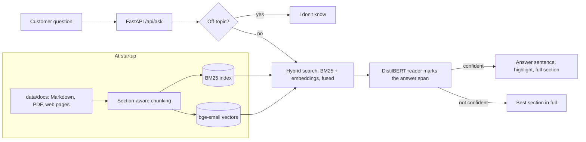

# telco-rag-assistant

[](https://github.com/momosto/telco-rag-assistant/actions/workflows/ci.yml)

**A support assistant that answers customer questions from a telecom provider's own documents, using two small AI models that run inside the app. No outside AI service, no API keys, and every answer shows where it came from.**

Live demo: **https://telco-rag-assistant.vercel.app**, with both models running inside a Vercel function on CPU.

The knowledge base belongs to **Mhepo Telecom, a fictional operator**: fibre plans, data bundles, billing, faults, SIM registration, roaming, fair usage and cancellations. No real company's documents or data are used.

## What it does

1. **Finds the right section** with hybrid search:
   - **Embeddings** (bge-small-en-v1.5) match meaning, so "I'm relocating, can I take my fibre with me?" finds *Moving house*.
   - **BM25 keywords** are exact on names, numbers and codes like *Fibre Plus* and `*300*9#`.
   - The two rankings are merged with reciprocal rank fusion.
2. **Reads it and marks the answer.** A question-answering model (DistilBERT fine-tuned on SQuAD) reads the top sections in one pass and highlights the exact span that answers the question, with a confidence score.
3. **Shows its evidence.** The reply is the sentence containing the answer, with the full section underneath so the customer can check it.
4. **Says "I don't know"** when the question is off-topic ("Who is the CEO?", "Do you sell laptops?") instead of guessing.
5. **Falls back gracefully.** When the reader isn't confident, it shows the best section in full, with tables rewritten as lines like "Fibre Plus: 50 / 25 Mbps, USD 85". Without the model files at all, it runs on keyword search alone.

Both models are int8-quantised ONNX files (about 100 MB together) run by `onnxruntime`, so no PyTorch and no GPU. An answer takes under 100 ms of compute on a laptop CPU, and about 1 second end to end on Vercel.

## Run it in 2 minutes

```bash
git clone https://github.com/momosto/telco-rag-assistant && cd telco-rag-assistant
docker compose up --build     # downloads the models into the image; then http://localhost:8000
```

Without Docker:

```bash
python -m venv .venv && . .venv/bin/activate      # Windows: .venv\Scripts\activate
pip install -r requirements-dev.txt
python scripts/download_models.py                  # ~100 MB, once
uvicorn app:app --reload                           # http://localhost:8000
pytest -q
```

## How it works



| Endpoint | Purpose |
|---|---|
| `POST /api/ask` `{"question": "..."}` | Answer text, `highlight` span, `confidence`, mode (`model`, `section` or `abstain`), citations, retrieved sections |
| `GET /api/health` | Mode (`local-models` or `keyword`) and index size |
| `GET /api/sources` | Documents in the knowledge base |
| `GET /` | Chat UI |

## Evaluation

```bash
python -m eval.run_eval              # 20 questions, scored on the facts in the answer and the cited document
python -m eval.retrieval_heldout     # 20 different questions, never used for tuning
```

| Test | Result |
|---|---|
| Answer evaluation (`eval/questions.json`) | **19/20 (95%)**: 16/16 answerable correct and cited, 3/4 off-topic declined |
| Held-out retrieval: right section ranked first | **16/20 (80%)** |
| Held-out retrieval: right section in the top two | **19/20 (95%)** |

**How to read these.** The answer evaluation was used while tuning (thresholds, synonyms, table handling), so treat 95% as an upper bound. The held-out questions were written afterwards and never tuned on, so they're the honest measure of how well it finds things. Before embeddings were added, keyword search alone scored 14/20 and 16/20 on the same held-out set.

**Known weaknesses:**

- The reader sometimes highlights a nearby phrase instead of the answer. "Is there a weekly data bundle?" highlights a rollover rule. The full section is always shown underneath for this reason.
- "I just got installed and changed my mind" (held-out) is declined as off-topic. Its words barely appear in the documents, and its meaning score (0.61) sits below the cut-off.
- "How much does an iPhone 17 cost?" (evaluation set) is answered with a SIM price instead of being declined.
- English only. Shona questions don't match yet.

## Design decisions

- **Self-contained by design.** Nothing leaves the server: no LLM API, no embedding API, no keys to leak or bills to run up. The models are pinned files the app loads from disk.
- **An extractive reader, not a generative model.** A reader can only return text that is in the documents, so it can't invent a price. The trade-off is that it highlights an answer rather than writing a fluent reply.
- **Hybrid search.** Embeddings alone ranked the contract-terms section above the price table for "How much is Fibre Plus per month?". Keywords alone missed "relocating" → *Moving house*. Fusing both fixes each one's blind spot.
- **One reading pass over the top sections.** The reader's confidence is a softmax over the text it is given. Read sections one by one and it can be 96% sure of "USD 5" inside the wrong section. Reading them together makes the candidate answers compete.
- **Thresholds are calibrated on the evaluation set, not the held-out set.** The similarity cut-off for overriding the off-topic rule (0.72) sits between the highest unanswerable score (0.69) and the lowest answerable one (0.74) in `eval/questions.json`.

## Hosting on Vercel

`app.py` exposes the FastAPI app, which Vercel runs as one Python function. The deployment includes the `models/` folder. Vercel's Python limit is 500 MB, and the models plus `onnxruntime`, `numpy` and `tokenizers` come to roughly 200 MB. Section vectors are computed in memory on each cold start, which takes about 1 second for this knowledge base.

## Roadmap

- A small generative model (e.g. Qwen2.5 1.5B) on Hugging Face Spaces, to turn the highlighted answer into a full sentence
- A multilingual embedding model so Shona questions work
- Agentic step: check a demo account balance before answering billing questions

## Project layout

```
rag/ingest.py       load and chunk Markdown, PDF and HTML
rag/retriever.py    BM25 index, synonyms, phrases, off-topic rule
rag/models.py       onnxruntime wrappers for the embedder and the reader
rag/hybrid.py       keyword + embedding fusion
rag/answer.py       reader answers, section fallback, abstain
rag/api.py          FastAPI routes and rate limit
static/index.html   chat UI
scripts/            model download
eval/               20 scored questions, 20 held-out retrieval questions, scripts
tests/              unit, model and API tests
data/docs/          fictional Mhepo Telecom knowledge base
```

## Credits

- [BAAI/bge-small-en-v1.5](https://huggingface.co/BAAI/bge-small-en-v1.5) (MIT) and [distilbert-base-cased-distilled-squad](https://huggingface.co/distilbert/distilbert-base-cased-distilled-squad) (Apache 2.0), via the ONNX exports in [Xenova](https://huggingface.co/Xenova)'s Hugging Face namespace.

MIT licensed. Built by [Simbarashe Nyamusa](https://simbarashe-nyamusa.vercel.app).
