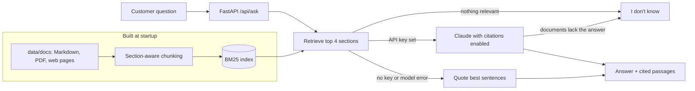

# telco-rag-assistant

[](https://github.com/momosto/telco-rag-assistant/actions/workflows/ci.yml)

**An AI support agent that answers customer questions from a telecom provider's own documents, and cites the passage it got each answer from.**

Live demo: **https://telco-rag-assistant.vercel.app** (quote-only mode, see below)

The knowledge base belongs to **Mhepo Telecom, a fictional operator**: fibre plans, data bundles, billing, faults, SIM registration, roaming, fair usage and cancellations. No real company's documents or data are used.

## What it does

- **Ingests** Markdown, text, PDF files and web pages, and splits them into sections that keep their headings, so a citation reads "Billing and payments > Ways to pay" rather than "chunk 17".
- **Retrieves** the most relevant sections with BM25 keyword search.
- **Answers with citations.** The retrieved sections go to Claude as documents with [citations](https://docs.claude.com/en/docs/build-with-claude/citations) enabled, so each sentence in the answer is tied to the exact text it came from. The chat UI shows those passages under every answer.
- **Says "I don't know"** when nothing relevant is found, or when the documents don't contain the answer, instead of guessing.
- **Degrades instead of failing.** Without an API key, or if the model call fails, it quotes the best-matching sentences directly from the documents, still with sources.
- **Is evaluated.** `eval/run_eval.py` runs 20 questions with known answers, including four that should be declined, and reports the share answered correctly and cited to the right document.

## Run it in 2 minutes

```bash
git clone https://github.com/momosto/telco-rag-assistant && cd telco-rag-assistant
cp .env.example .env          # add ANTHROPIC_API_KEY for AI answers; leave blank for quote-only mode
docker compose up --build     # http://localhost:8000
```

Without Docker:

```bash
python -m venv .venv && . .venv/bin/activate      # Windows: .venv\Scripts\activate
pip install -r requirements-dev.txt
uvicorn app:app --reload                           # http://localhost:8000
pytest -q
```

## How it works



| Endpoint | Purpose |
|---|---|
| `POST /api/ask` `{"question": "..."}` | Answer, mode (`claude`, `extractive` or `abstain`), citations and retrieved sections |
| `GET /api/health` | Mode and index size |
| `GET /api/sources` | Documents in the knowledge base |
| `GET /` | Chat UI |

## Evaluation

```bash
python -m eval.run_eval                        # Claude mode (needs ANTHROPIC_API_KEY)
RAG_MODE=extractive python -m eval.run_eval    # quote-only mode, free; runs in CI
```

An answerable question passes only if every expected fact is in the answer **and** a citation points at the right document. An unanswerable one passes only if the assistant declines.

| Mode | Score | Answerable | Correctly declined |
|---|---|---|---|
| Quote-only (no model) | 15/20 (75%) | 12/16 | 3/4 |
| Claude | run `python -m eval.run_eval` with a key; results land in `eval/results-claude.md` | | |

The quote-only baseline is deliberately simple. It fails where the answer sits in a table row or needs two facts combined, and it can't tell that a question about iPhone prices is out of scope. Those gaps are what the model is for.

## Design decisions

- **BM25 instead of embeddings, for now.** For a few dozen sections, keyword search finds the right one in the top four for every evaluation question. It needs no second API key and keeps serverless cold starts fast. `BM25Retriever.search()` is the seam where a pgvector or Chroma retriever would plug in.
- **Native citations instead of asking the model to write `[1]`.** The API returns the exact cited span, so citations can't point at text that isn't in the source.
- **Abstain at two layers.** Retrieval returns nothing unless a section shares at least two distinct words with the question (one shared word, like "offer" or "rate", is what off-topic questions look like), and the prompt tells the model to decline when the retrieved sections don't contain the answer.
- **Cheap by default.** Effort is set to `low` for short support answers, the public demo runs without a key, and `/api/ask` has a per-IP rate limit (best-effort on serverless; put a gateway limiter in front of a paid deployment).

## Hosting on Vercel

`app.py` exposes the FastAPI app, which Vercel runs as a single Python function. The index is rebuilt in memory on each cold start, which takes milliseconds at this size. To enable AI answers on a deployment, add `ANTHROPIC_API_KEY` in the project's environment variables. Everything on that deployment then spends from your Anthropic account.

## Roadmap

- Hybrid retrieval: embeddings in pgvector alongside BM25, with Shona query support (BM25 can't match "neEcoCash" to "EcoCash")
- Agentic tool call: check a demo account balance before answering billing questions
- Streaming answers in the chat UI

## Project layout

```
rag/ingest.py      load and chunk Markdown, PDF and HTML
rag/retriever.py   BM25 index
rag/answer.py      Claude with citations, quote-only fallback, abstain logic
rag/api.py         FastAPI routes and rate limit
static/index.html  chat UI
eval/              20 questions and the scoring script
tests/             unit and API tests (Claude calls are faked; no key needed)
data/docs/         fictional Mhepo Telecom knowledge base
```

MIT licensed. Built by [Simbarashe Nyamusa](https://simbarashe-nyamusa.vercel.app).
